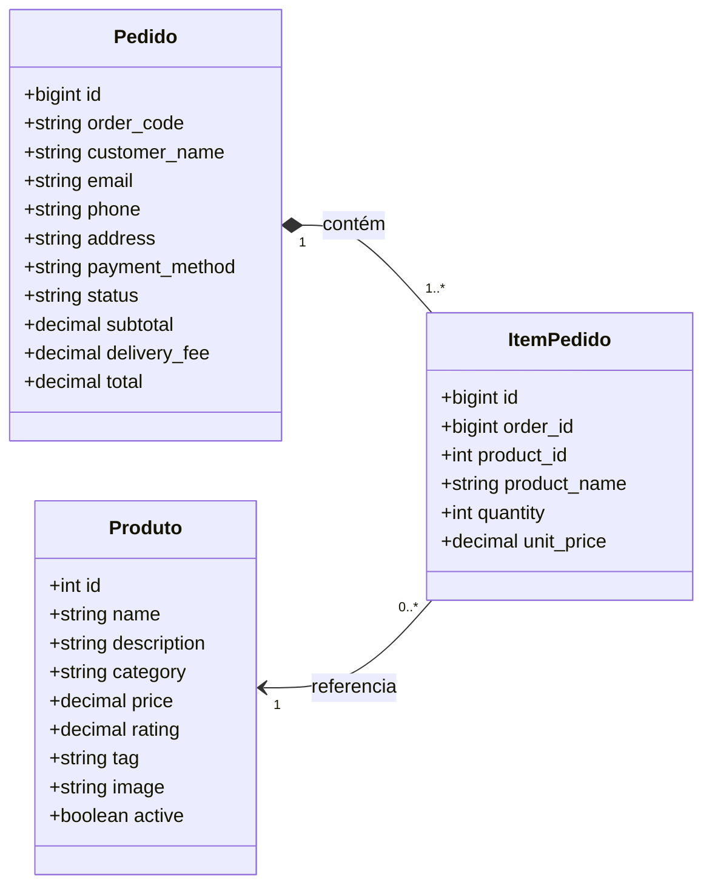
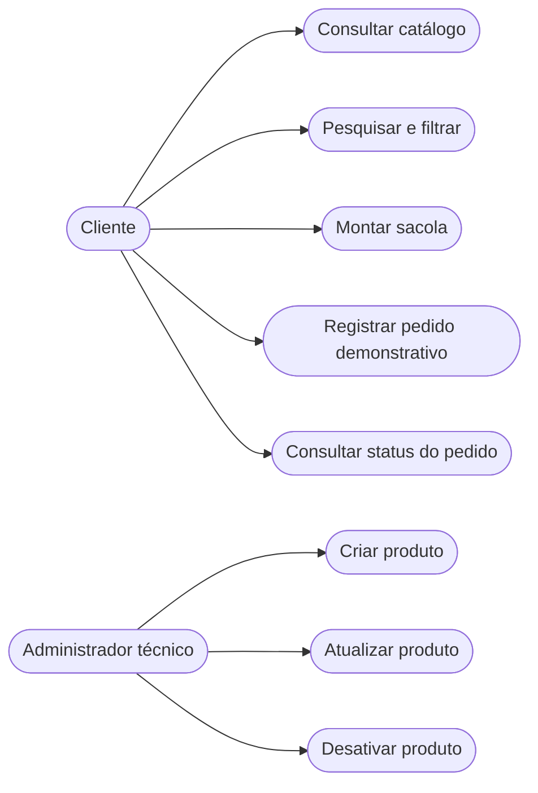
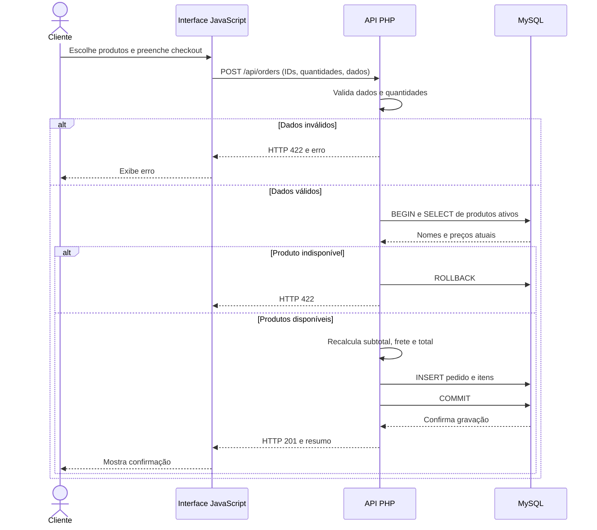
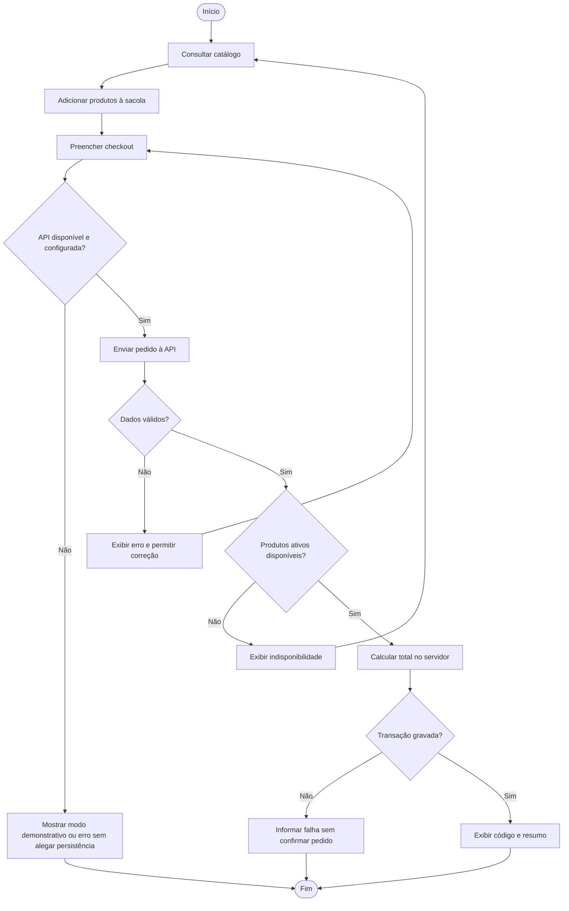

# Diagramas UML — Cupcake Gourmet

**Base de modelagem:** implementação atual em `index.html`, `app.js`, `api/index.php` e `database/schema.sql`. Os diagramas representam responsabilidades lógicas; o PHP atual é procedural, portanto as classes abaixo são **classes conceituais de domínio**, não classes PHP já implementadas.

## 1. Diagrama de classes conceitual

**Nota:** `Pedido` e `ItemPedido` armazenam valores históricos; a API valida os itens e calcula os preços no servidor. A cardinalidade de ao menos um item é uma regra de negócio aplicada pela API, não uma restrição de cardinalidade diretamente expressa pelo SQL.

## 2. Casos de uso (representação de atores e funcionalidades)

O acesso administrativo é por token de API; não há painel de login de administrador implementado.

## 3. Diagrama de sequência — registro de pedido

## 4. Diagrama de atividades — checkout

## 5. Rastreabilidade

| Elemento | Implementação / evidência |
|---|---|
| Produto, Pedido, ItemPedido | `database/schema.sql` |
| Catálogo e sacola | `index.html`, `app.js` |
| Validação e persistência de pedidos | `api/index.php` |
| Regras e requisitos | `docs/documentacao-academica.md` |
| Casos de teste | `docs/roteiro-testes.md` |

Estes diagramas documentam a arquitetura atual. Não constituem prova de execução dos testes.
