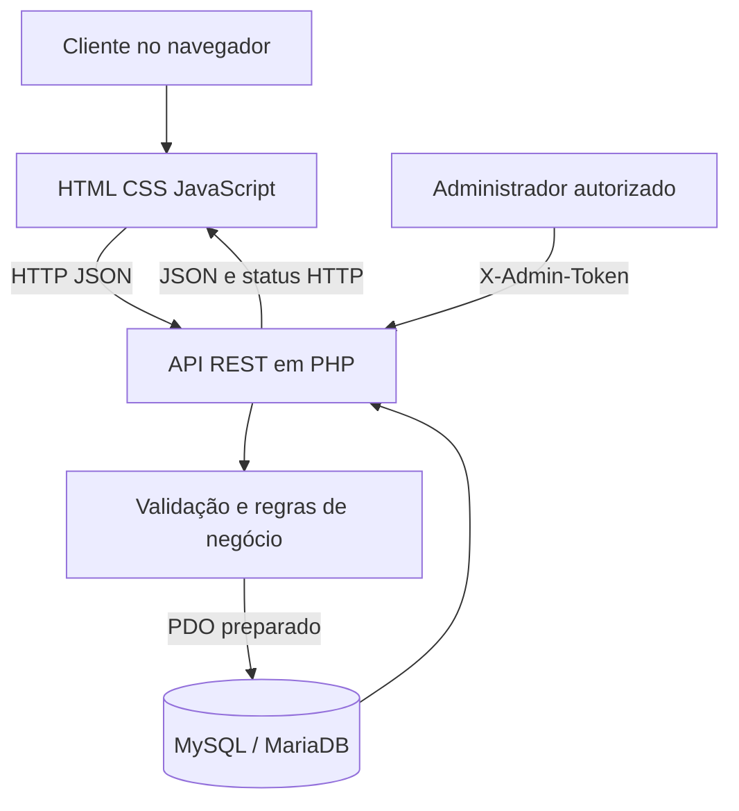
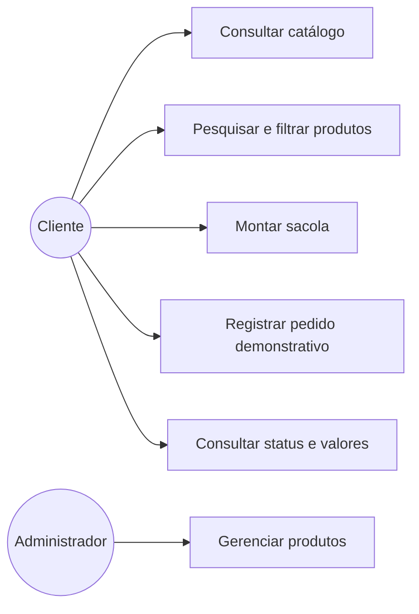

# Documentação acadêmica — Cupcake Gourmet

**Tipo de trabalho:** Projeto Integrador / Sistema Web  
**Versão documental:** 1.0  
**Situação:** documentação técnica inicial; preencher instituição, curso, disciplina, autores, orientador e data conforme a folha de rosto exigida pela instituição.

## Resumo

O Cupcake Gourmet é uma aplicação web responsiva concebida para apresentar um catálogo de cupcakes artesanais e permitir a montagem de uma sacola e o registro demonstrativo de pedidos. A solução separa a interface do serviço de dados: HTML, CSS e JavaScript compõem o front-end; PHP implementa uma API REST; e MySQL/MariaDB persiste produtos, pedidos e itens de pedido. O servidor valida os dados e calcula os preços com base no catálogo armazenado, reduzindo a possibilidade de manipulação dos valores enviados pelo cliente. O projeto utiliza consultas preparadas, transações e chaves estrangeiras. O processamento de pagamento permanece fora do escopo: as opções são identificadas explicitamente como simulação.

**Palavras-chave:** sistema web; PHP; MySQL; API REST; e-commerce; banco de dados.

## 1. Introdução

Pequenos negócios de confeitaria podem se beneficiar de uma vitrine digital organizada, que facilite a consulta dos produtos e a composição de pedidos. O projeto propõe uma interface com identidade visual temática, filtros por categoria, busca textual, detalhes de produtos e sacola de compras. A inclusão de uma API e de um banco relacional permite que o catálogo e os pedidos persistam entre sessões e dispositivos, desde que a aplicação esteja instalada em um servidor configurado.

## 2. Problema e justificativa

Uma vitrine exclusivamente estática não persiste pedidos e não oferece uma fonte central de preços. Além disso, calcular o total apenas no navegador permite adulteração. A API centraliza a validação e o cálculo, enquanto o banco relacional organiza pedidos e seus itens com integridade referencial. A escolha de PHP e MySQL também favorece implantação acessível em hospedagens web comuns.

## 3. Objetivos

### 3.1 Objetivo geral

Desenvolver uma aplicação web responsiva para catálogo e registro demonstrativo de pedidos de uma confeitaria, com back-end e banco de dados relacional.

### 3.2 Objetivos específicos

- Apresentar produtos com nome, descrição, categoria, imagem, avaliação e preço.
- Permitir busca, filtros, visualização de detalhes e manipulação da sacola.
- Validar dados do cliente e os itens enviados no checkout.
- Calcular subtotal e total no servidor usando preços persistidos.
- Armazenar pedidos e itens de forma transacional.
- Disponibilizar endpoints de leitura do catálogo e operações administrativas protegidas.
- Documentar arquitetura, modelo de dados, API, instalação e plano de testes.

## 4. Escopo

### Incluído

- Front-end responsivo e interativo.
- API PHP com endpoints de produtos, pedidos e verificação de saúde.
- Persistência MySQL/MariaDB de produtos, pedidos e itens.
- Validação básica de entrada, consultas preparadas e transação de pedido.
- CRUD administrativo de produtos protegido por token.
- Documentação de instalação, dados, API e roteiro de testes.

### Fora do escopo atual

- Pagamento real e integração com gateway.
- Autenticação completa de funcionários/administradores e painel administrativo visual.
- Gestão de estoque, cupons, cálculo geográfico de frete, notificações, rastreamento logístico e emissão fiscal.
- Aplicativo móvel nativo.
- Operação comercial em produção sem hardening, auditoria, testes e políticas de privacidade adicionais.

## 5. Stakeholders e perfis

- **Visitante/cliente:** consulta o cardápio, monta a sacola e registra pedido demonstrativo.
- **Administrador técnico:** gerencia produtos por endpoints autenticados com token.
- **Equipe de desenvolvimento/avaliação:** instala, testa e documenta a aplicação.

## 6. Requisitos funcionais

| ID | Requisito |
|---|---|
| RF01 | O sistema deve listar produtos ativos com informações de catálogo. |
| RF02 | O usuário deve poder pesquisar produtos por texto. |
| RF03 | O usuário deve poder filtrar produtos por categoria. |
| RF04 | O usuário deve poder consultar detalhes de um produto. |
| RF05 | O usuário deve poder adicionar, remover e alterar quantidades na sacola. |
| RF06 | A interface deve apresentar subtotal, taxa demonstrativa e total estimado. |
| RF07 | O sistema deve validar nome, e-mail, telefone, endereço, forma de pagamento demonstrativa e itens. |
| RF08 | O servidor deve buscar os preços vigentes no banco e recalcular o total. |
| RF09 | O sistema deve persistir o pedido e seus itens em uma transação. |
| RF10 | O usuário deve receber código e resumo do pedido após gravação bem-sucedida. |
| RF11 | O sistema deve permitir consultar status e valores do pedido sem expor endereço ou contatos. |
| RF12 | O administrador autorizado deve criar, editar e desativar produtos. |
| RF13 | O sistema deve retornar erros JSON e códigos HTTP apropriados. |

## 7. Requisitos não funcionais

| ID | Requisito |
|---|---|
| RNF01 | Interface responsiva para desktop, tablet e celular. |
| RNF02 | Comunicação front-end/API em JSON e UTF-8. |
| RNF03 | Consultas ao banco devem usar parâmetros preparados. |
| RNF04 | Pedido e itens devem ser persistidos atomicamente. |
| RNF05 | Segredos não devem ser incluídos no JavaScript nem no repositório público. |
| RNF06 | Dados pessoais devem ter acesso restrito e retenção definida antes do uso real. |
| RNF07 | O sistema deve informar indisponibilidade da API sem simular persistência. |
| RNF08 | O código deve ser organizado em arquivos separados por responsabilidade. |
| RNF09 | A implantação deve usar HTTPS em ambiente público. |
| RNF10 | A aplicação deve ser testada no ambiente de destino antes da entrega/produção. |

## 8. Regras de negócio

- RB01: apenas produtos ativos podem ser exibidos ou incluídos em pedidos novos.
- RB02: o preço usado no pedido é o preço do banco no momento da criação, não o preço informado pelo navegador.
- RB03: a taxa de entrega é fixa em R$ 8,00 nesta versão demonstrativa.
- RB04: cada item aceita quantidade inteira entre 1 e 20; o payload aceita até 30 produtos diferentes.
- RB05: formas de pagamento são opções de demonstração e não geram cobrança.
- RB06: ao desativar um produto, pedidos históricos continuam preservando nome e preço unitário no item do pedido.
- RB07: um pedido só deve ser considerado registrado após a transação ser confirmada.

## 9. Metodologia e processo de desenvolvimento

A abordagem recomendada é incremental, com entregas verificáveis: (1) interface e catálogo; (2) esquema relacional; (3) endpoints de leitura; (4) criação transacional de pedidos; (5) proteção administrativa; (6) documentação e testes. Para uma disciplina que exija Scrum, registrar product backlog, sprint backlog, revisão e retrospectiva com as datas e participantes reais. Não se deve declarar cerimônias ou resultados que não tenham ocorrido.

## 10. Arquitetura

A solução segue uma arquitetura cliente-servidor em três partes lógicas:

1. **Apresentação:** `index.html`, `styles.css` e `app.js` renderizam a interface e interagem com o usuário.
2. **Aplicação/API:** `api/index.php` valida requisições, aplica regras de negócio e produz JSON.
3. **Persistência:** MySQL/MariaDB guarda catálogo, pedidos e linhas de pedido.

O front-end não tem credenciais do banco. A API utiliza PDO e consultas preparadas. O pedido é salvo em transação para evitar registros incompletos entre a tabela `orders` e `order_items`.

## 11. Casos de uso

### Fluxo principal: registrar pedido

1. O cliente consulta o catálogo e adiciona produtos à sacola.
2. A interface apresenta quantidades e total estimado.
3. O cliente informa dados de contato, endereço e opção de pagamento demonstrativa.
4. O front-end envia IDs e quantidades à API.
5. A API valida os campos, consulta os produtos ativos e recalcula os valores.
6. A API grava pedido e itens na mesma transação.
7. Em caso de sucesso, devolve código e resumo; em caso de erro, devolve mensagem sem limpar a sacola.

### Fluxos alternativos

- Dados inválidos: a API responde HTTP 422 com uma mensagem de validação.
- Produto removido/inativo: a API recusa o pedido e solicita atualização do catálogo.
- Banco indisponível: a API retorna erro genérico e registra detalhes técnicos apenas no log do servidor.
- API indisponível no navegador: a interface pode mostrar catálogo local para demonstração, mas não confirma o pedido como persistido.

## 12. Tecnologias e justificativa da escolha

- **HTML5:** estrutura semântica da interface.
- **CSS3:** identidade visual, responsividade e estados de interação.
- **JavaScript:** filtros, sacola e chamadas `fetch` para a API.
- **PHP 8.1+:** linguagem do back-end, disponível em hospedagens web comuns e adequada para endpoints de escopo pequeno.
- **PDO:** camada de acesso a dados com consultas preparadas.
- **MySQL/MariaDB:** banco relacional, transações e chaves estrangeiras.

PHP foi escolhido em vez de Java/Spring Boot porque o escopo é uma aplicação web pequena com front-end já existente e foco em facilidade de instalação. Java seria tecnicamente válido, mas adicionaria JVM, empacotamento e configuração de execução. A escolha não significa que PHP seja universalmente superior; é a alternativa mais proporcional aos requisitos e ao cenário de implantação previsto.

## 13. Segurança, privacidade e limitações

O código usa validação no servidor, consultas preparadas e respostas com mensagens genéricas de erro. A chave administrativa fica em arquivo PHP do servidor e é enviada apenas em operações administrativas. Ainda assim, token compartilhado não substitui autenticação individual. Para produção, são necessários HTTPS, rate limiting, gestão de segredos, backups, monitoramento, política de retenção, aviso de privacidade e avaliação de conformidade com a LGPD. Os dados de contato/endereço são dados pessoais. Pagamentos não são processados; não coletar dados de cartão.

## 14. Implantação

A instalação detalhada consta em `README.md`. Resumo: configurar PHP 8.1+ com PDO MySQL e mbstring; importar `database/schema.sql`; criar `config/database.php` a partir do exemplo; configurar servidor web com HTTPS e rewrite; validar `/api/health`; testar catálogo e pedido; e verificar as tabelas no banco. Para produção, não usar credenciais de desenvolvimento e não expor logs ou arquivos de configuração.

Para avaliar somente a interface, `index.html` também pode ser aberto pela extensão Live Server do Visual Studio Code. Nesse modo, o catálogo local, busca, filtros, sacola e checkout demonstrativo funcionam no navegador; a confirmação é identificada como resumo local e não representa gravação de pedido. Live Server não executa PHP nem substitui a instalação do back-end e do banco descrita acima.

## 15. Plano de testes e critérios de aceite

O plano completo está em `roteiro-testes.md`. Critérios mínimos: produtos são carregados pela API; dados inválidos são rejeitados; valores de pedido são recalculados no servidor; pedidos e itens persistem de forma consistente; operações administrativas sem token válido são recusadas; e nenhum endpoint público de consulta de pedido expõe telefone, e-mail ou endereço. Registrar evidências e resultados após execução real.

## 16. Resultados esperados e conclusão

Espera-se que o sistema apresente catálogo e sacola interativos e registre pedidos em banco relacional por meio da API. A arquitetura separada facilita manutenção e futura ampliação para autenticação, estoque e pagamento integrado. O projeto ainda requer execução dos testes no ambiente final e hardening adicional antes de uso comercial. A documentação deve ser completada com identificação acadêmica e evidências reais de execução.

## Referências técnicas sugeridas

- PHP Manual. https://www.php.net/manual/pt_BR/
- PHP Data Objects (PDO). https://www.php.net/manual/pt_BR/book.pdo.php
- MySQL Reference Manual. https://dev.mysql.com/doc/
- OWASP Cheat Sheet Series. https://cheatsheetseries.owasp.org/
- Lei Geral de Proteção de Dados Pessoais — Lei nº 13.709/2018. https://www.planalto.gov.br/ccivil_03/_ato2015-2018/2018/lei/l13709.htm

## Checklist de personalização antes da entrega

- [ ] Inserir nome da instituição, curso, disciplina, autores, professor e data.
- [ ] Adequar capa, citações e referências ao padrão exigido (ex.: ABNT) pela instituição.
- [ ] Executar e preencher o roteiro de testes com resultados reais.
- [ ] Adicionar capturas de tela próprias da aplicação em execução.
- [ ] Confirmar se o professor exige diagramas, cronograma, orçamento ou metodologia específicos.
- [ ] Substituir produtos, preços, frete e imagens de exemplo pelos dados autorizados do projeto.
