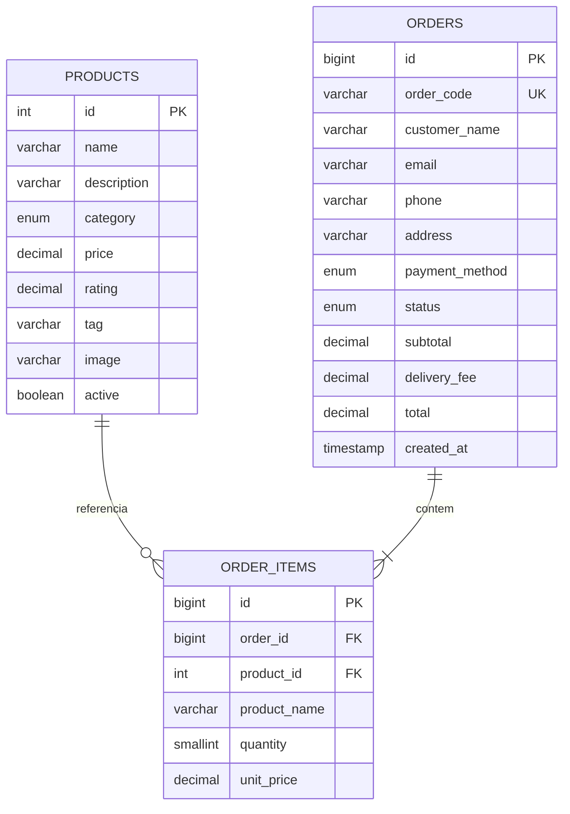

# Modelo de dados — Cupcake Gourmet

## Visão geral

O banco `cupcake_gourmet` possui três entidades persistentes: `products`, `orders` e `order_items`. `orders` guarda um snapshot dos dados de contato/endereço necessários para atender o pedido; `order_items` guarda também o nome e preço unitário no momento da compra, para preservar o histórico mesmo que o cadastro do produto mude.

## Diagrama entidade-relacionamento

## Dicionário de dados

### `products`

| Campo | Tipo | Regra / finalidade |
|---|---|---|
| id | INT UNSIGNED | Chave primária auto incremento |
| name | VARCHAR(120) | Nome obrigatório |
| description | VARCHAR(1000) | Descrição obrigatória |
| category | ENUM | Clássicos, Especiais ou Frutados |
| price | DECIMAL(10,2) | Preço positivo em reais |
| rating | DECIMAL(2,1) | Avaliação de 0 a 5 |
| tag | VARCHAR(60) | Selo promocional |
| image | VARCHAR(1000) | URL de imagem |
| active | TINYINT(1) | 1 ativo; 0 desativado |
| created_at / updated_at | TIMESTAMP | Auditoria temporal básica |

### `orders`

| Campo | Tipo | Regra / finalidade |
|---|---|---|
| id | BIGINT UNSIGNED | Chave primária |
| order_code | VARCHAR(20) | Código único mostrado após o registro |
| customer_name | VARCHAR(150) | Nome do cliente |
| email | VARCHAR(254) | E-mail de contato |
| phone | VARCHAR(30) | Telefone de contato |
| address | VARCHAR(500) | Endereço informado para entrega |
| payment_method | ENUM | Uma das opções identificadas como simulação |
| status | ENUM | Estado do pedido |
| subtotal | DECIMAL(10,2) | Soma dos itens recalculada no servidor |
| delivery_fee | DECIMAL(10,2) | Taxa de entrega demonstrativa |
| total | DECIMAL(10,2) | Subtotal + taxa |
| created_at | TIMESTAMP | Data/hora de criação |

### `order_items`

| Campo | Tipo | Regra / finalidade |
|---|---|---|
| id | BIGINT UNSIGNED | Chave primária |
| order_id | BIGINT UNSIGNED | FK para `orders`, com exclusão em cascata |
| product_id | INT UNSIGNED | FK para `products` |
| product_name | VARCHAR(120) | Snapshot do nome do produto |
| quantity | SMALLINT UNSIGNED | Quantidade inteira positiva |
| unit_price | DECIMAL(10,2) | Snapshot do preço unitário no pedido |

## Integridade e decisões

- InnoDB permite transação e integridade referencial.
- `DECIMAL` é usado para valores monetários, evitando erros de ponto flutuante na persistência.
- `order_code` tem restrição única.
- Um produto é desativado por `active=0`, preservando referências históricas.
- A API grava `orders` e `order_items` em uma única transação.
- O banco guarda dados pessoais de clientes no registro do pedido; em operação real, implementar política de acesso, retenção e eliminação conforme base legal aplicável e LGPD.
