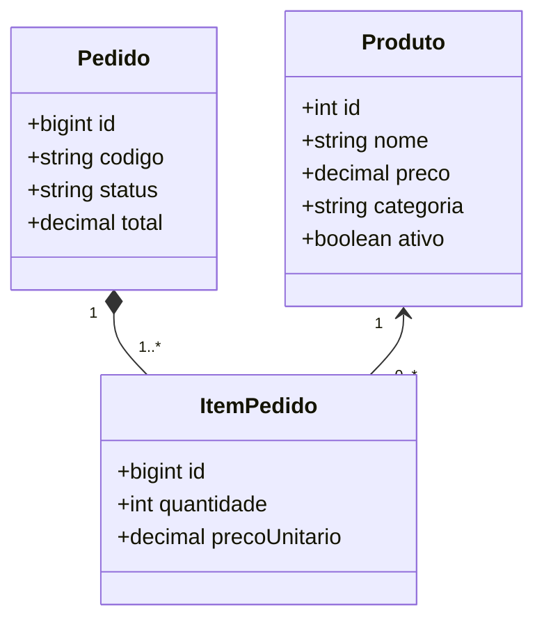
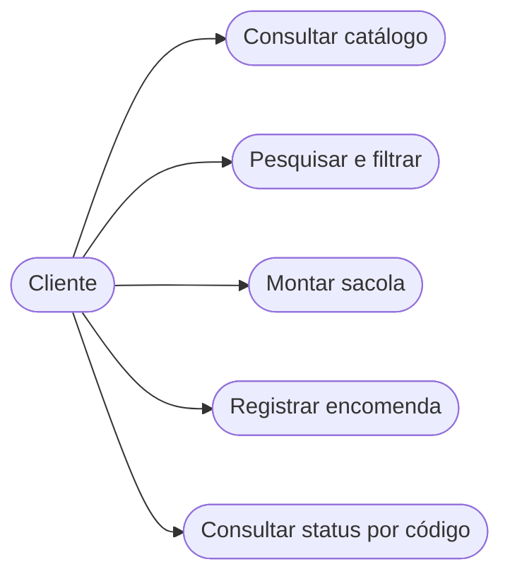
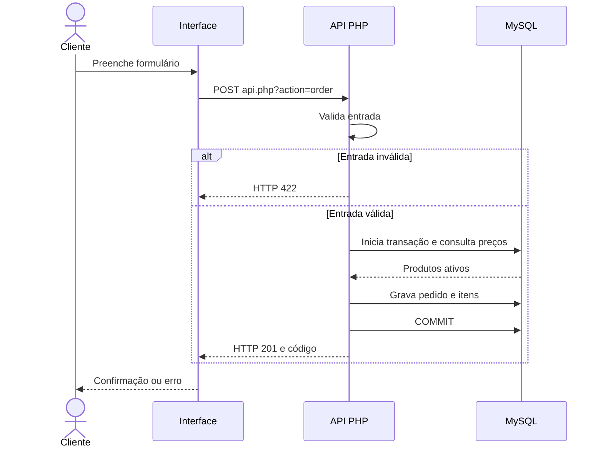
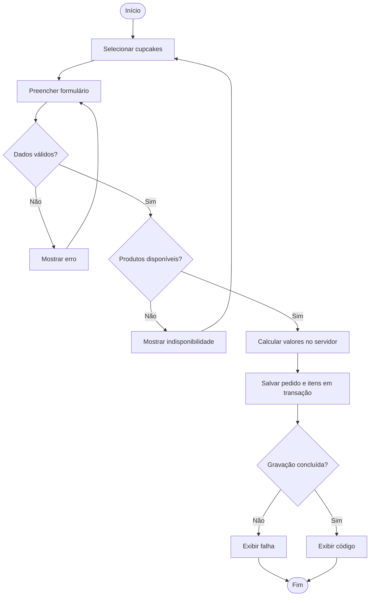

# Relatório técnico — Cupcake Gourmet

## Contexto, objetivo e escopo
Projeto Integrador Transdisciplinar em Engenharia de Software II. Solução web demonstrativa para uma confeitaria, destinada à consulta de cupcakes e registro de encomendas. O sistema não processa pagamentos reais, não gerencia entregadores e não tem autenticação de clientes.

## Requisitos
**RF01** listar produtos ativos; **RF02** pesquisar por nome; **RF03** filtrar categoria; **RF04** adicionar/remover/alterar quantidade da sacola; **RF05** preencher dados e escolher pagamento simulado; **RF06** validar e persistir pedido e itens; **RF07** consultar pedido por código.
**RNF01** interface responsiva; **RNF02** mensagens de erro; **RNF03** consultas preparadas; **RNF04** integridade referencial; **RNF05** preços calculados no servidor.

## Arquitetura
HTML/CSS/JavaScript (cliente) → PHP/PDO (API) → MySQL/MariaDB. A API é procedural e não implementa classes PHP. A representação de classes abaixo é **conceitual**.

## UML: classes conceituais

## Casos de uso

## Sequência: registrar pedido

## Atividades: checkout

## Modelagem e normalização
Modelo conceitual: Produto, Pedido, ItemPedido. Modelo lógico: products(id PK), orders(id PK, code UNIQUE), order_items(id PK, order_id FK, product_id FK). Separação de itens elimina grupos repetidos (1FN); atributos não-chave dependem da chave de sua entidade (2FN); dados de produto são centralizados, mas nome e preço são copiados para o item como **instantâneo histórico deliberado**. O dicionário detalhado está em `docs/dicionario-de-dados.md`.

## IHC e UX
Layout responsivo; busca visível; categorias; botão de sacola com contador; checkout com rótulos e validação nativa; feedback textual com `role=status`; estados vazios e erros. Revisar com cinco usuários reais, registrando sugestões e correções.

## Limites
Sem pagamento real, autenticação, painel administrativo, envio de e-mail ou hospedagem de produção. Projeto para demonstração local. Não inserir dados pessoais reais nos testes. O relatório descreve a solução proposta e o código, não comprova por si só a execução.
